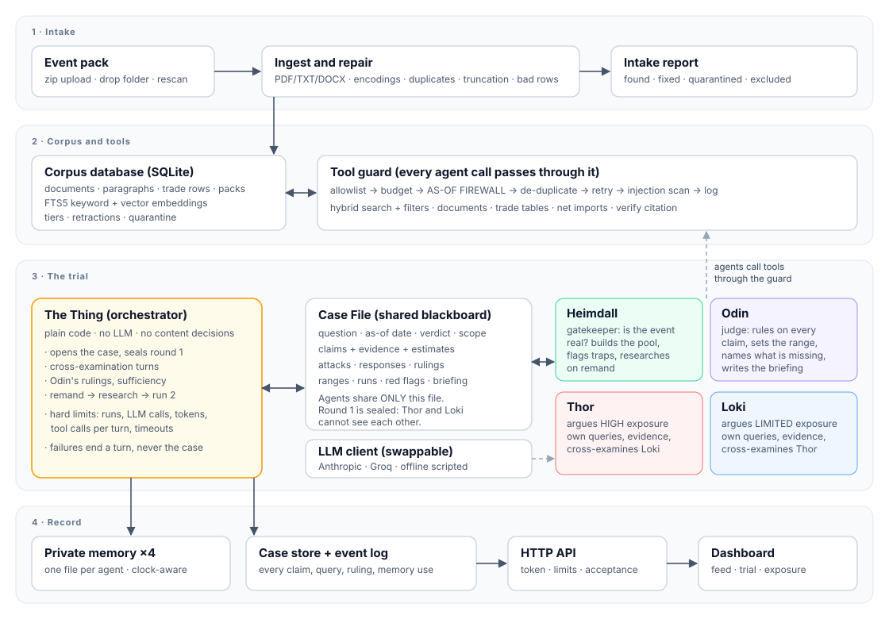
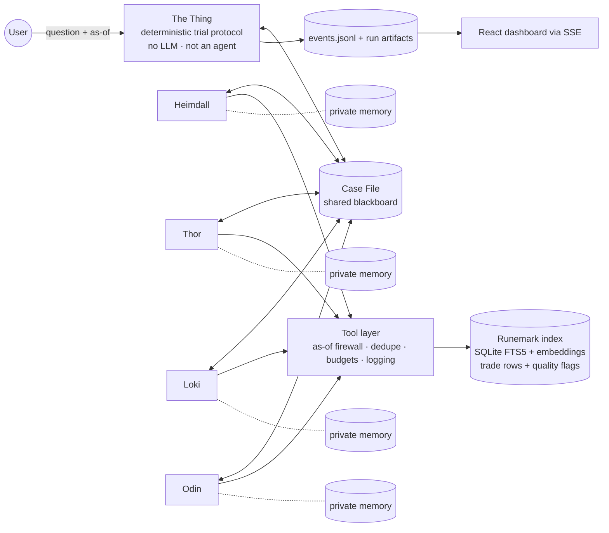

# ⚖️ Trial of the Nine Realms

**An adversarial multi-agent system that puts every supply-chain disruption on trial.**

Ask a question about a disruption in **Runemark**. Four Norse agents build the case, argue opposite sides and rule on every claim. The result is a briefing that separates **what is certain, what is disputed, and how wide the risk range is**, with every number and sentence traceable to a Runemark document or trade-table row.

| Agent | Role | Does | Never |
|---|---|---|---|
| 🌈 **Heimdall** | Gatekeeper | Turns the question into a Case File, gathers evidence, checks the event is real, re-searches on remand | Argues or judges |
| ⚡ **Thor** | The Alarm | Builds the strongest honest case that exposure is **high**, with cited claims and a range | Cites without a source |
| 🐍 **Loki** | The Trickster | Builds the strongest honest case that exposure is **limited**, with cited claims and a range | Says "maybe it'll be fine" |
| 👁 **Odin** | The Allfather (judge) | Rules on every claim, classifies findings, decides sufficiency, sends the case back, writes the briefing | Plans, assigns or searches |

---

## Run it: the working system (`nine_realms/`)

The build that is tested end to end, containerised and used for the demo is the Python package `nine_realms/` with its dashboard (`index.html`, `app.js`).
It has no build step. `backend/` and `frontend/` (FastAPI + React) are the original spec-first scaffold described in `docs/`; they are not needed to run the demo.

```bash
git clone https://github.com/parthtiwaskar/ragnarok_iit_Astral_walkers && cd ragnarok_iit_Astral_walkers
pip install -r requirements-nine-realms.txt
cp .env.example .env              # add ONE key: DEEPSEEK_API_KEY, ANTHROPIC_API_KEY or OPENAI_API_KEY (set NINE_REALMS_PROVIDER if several)
python -m nine_realms.server      # http://127.0.0.1:8765  (first start ingests data/runemark into data/ragnarisk.sqlite)
```

Open the dashboard, ask a question on the **Ask** screen and choose **Full trial** (two runs, with Odin's remand). *Fast answer* is one run and is meant for quick questions.
Browsing the corpus and saved cases needs no key.

| Task | How |
|---|---|
| Add a new event pack **live**, no code change, no restart | Evidence page, Data intake, *Upload pack (.zip)*; or `POST /api/ingest` (zip body); or drop a folder or zip into `data/live_packs/` |
| Ask with a simulated clock | Write it in the question ("As of 25 January 2027, ..."); the date is read from the text |
| Check a case against the 10 minimum criteria | `python -m nine_realms.acceptance <case_id>` (also shown at the bottom of the Briefing page) |
| Produce the submission log in one command | `python -m nine_realms.realrun` (checks the key, runs a Full trial, writes `runs/<case_id>/` only if it is a valid two-run case) |
| Save a case as the submission log | `python -m nine_realms.export <case_id>` writes `runs/<case_id>/` (`case.json`, `events.jsonl`, `briefing.md`, `acceptance.json`) |
| Rehearse the final round with no key | `python -m nine_realms.rehearsal --out /tmp/pack_e9 --kind damaged`, then `python -m nine_realms.dryrun --extra-pack /tmp/pack_e9`. This is a **scripted** court over the real corpus: it proves the pipeline, not model quality |
| Run the tests | `python -m pytest nine_realms/tests` |
| Deploy (Docker, Render) | [`deploy/README.md`](deploy/README.md), [`render.yaml`](render.yaml) |

More: [architecture of the working build](docs/FINAL_ARCHITECTURE.md) · [final-round strategy and runbook](docs/FINAL_ROUND_STRATEGY.md) · [`nine_realms/README.md`](nine_realms/README.md) · [pitch script](docs/PITCH_SCRIPT.md)



### What is not done or not verified

- The saved two-run log from a **real model** is added to `runs/` when it completes; until then `runs/E5-24322/` is an earlier, incomplete real run.
- The enforced debate rules and the exposure metric (net change in the importing country's total imports, by value) are tested with scripted models; real-model behaviour is checked on the first real run.
- Range accuracy cannot be measured by us: the organisers hold the true exposure.
- Live ingestion is rehearsed on packs we generated with every damage type, not on an unseen real pack.

---

## Architecture (design spec)



**Flow:** USER → HEIMDALL → THOR ∥ LOKI (sealed) → cross-examination → ODIN → briefing **or** remand → Heimdall re-search → next run.

- **No boss.** The Thing is court procedure (turn order, sealed submissions, limits), not a planner. Agents decide everything about content. Odin's remand lists *deficiencies*, never instructions.
- **LLMs argue, code computes.** Exposure is a deterministic function of cited parameters (route share × severity × duration × (1 − reroute offset)). Odin's rulings decide which bounds survive.
- **Grounding is enforced.** Every citation is checked against the manifest, the as-of date, retractions (as of that date), the event ID and an exact-quote match.

Full details: [docs/ARCHITECTURE.md](docs/ARCHITECTURE.md)

---

## Features

- **Ingestion** of PDF, TXT and DOCX documents, trade tables and reference sheets. Damaged files are quarantined with reasons, and bad trade rows are flagged and excluded, never used silently. **Live packs** dropped into `data/live_packs/` are indexed automatically.
- **Hybrid search**: BM25 (SQLite FTS5) + dense (bge-small) fused with RRF, with filters on event, country, sector, tier, source type, date and background.
- **Real debate**: sealed simultaneous claims, mandatory cross-examination, defences that must bring *new* evidence, honest concessions.
- **Judge with teeth**: rulings on every claim (sourced fact vs inference; Established / Contested / Conceded), a sufficiency check, a remand, and a second run with new evidence.
- **Private lasting memory** per agent, with logged `memory_influence` events. Memory obeys the simulated clock (`knowledge_date`).
- **Trap handling**: rumours, retractions, corrections, contradictions, prompt injections, look-alike docs, future information.
- **Dashboard**: question box, live feed replay, trial view, exposure range table, click-through to the exact quote or trade row, logs, ingestion, memory.
- **Reproducible**: event-sourced logs, per-run artifacts, and a deterministic `replay`.

---

## Quickstart for the spec scaffold (`backend/` + React)

This section follows the original design in `docs/`. For the working build, use *Run it* above.

```bash
git clone https://github.com/<team>/nine-realms && cd nine-realms
cp .env.example .env              # add OPENAI_API_KEY and/or ANTHROPIC_API_KEY, choose LLM_PROVIDER
# put the Runemark folder at data/runemark/

# backend
cd backend && python -m venv .venv && source .venv/bin/activate
pip install -e ".[dev]"
python cli.py ingest              # builds the index, prints the ingestion report
uvicorn app.main:app --reload     # http://localhost:8000

# frontend (new terminal)
cd frontend && npm install && npm run dev   # http://localhost:5173
```

Or `make up` (docker compose: backend + frontend).

### Dashboard and API

Run `make ingest` once, then `make dev` to start the FastAPI service at `http://localhost:8000` and
`cd frontend && npm run dev` for the dashboard at `http://localhost:5173`. The dashboard opens cases,
projects the case SSE stream, presents the trial and exposure rows, and opens documents or trade rows from
citation chips. The REST contract is documented in [`docs/API.md`](docs/API.md).

### Verified E5 rehearsal

The supplied sample question was run on 2026-10-25 with `FakeLLM` and hash embeddings:

```text
CASE-20261025-6a38 · 3 runs · INCOMPLETE: MAX_RUNS_REACHED_INSUFFICIENT
```

This is an expected safe outcome for the deterministic offline policy player: it preserves the insufficiency
rather than inventing a complete result. Run `make e5` to repeat it.

### CLI

```bash
python cli.py ingest [--path data/live_packs/pack1]
python cli.py ask "How exposed is <country>'s <sector> to <event>?" --as-of 2025-03-20
python cli.py replay <case_id>         # rebuild briefing from saved rulings, no LLM
python cli.py score  <case_id> [--truth truth.json]
python cli.py export <case_id> --zip
python cli.py memory-reset --agent all
```

## Dataset

The E5 challenge corpus is included at [`data/runemark/`](data/runemark/). It contains the original 76 PDF, TXT and DOCX documents, `manifest.json`, `hashes.sha256`, and the pack's README and sample question. Verify the source files from that directory with `sha256sum -c hashes.sha256`.

The pack's `runemark_map.png` is a human-reference image only; do not pass it to agents or the retrieval pipeline.

---

## Example output (briefing excerpt)

```
# Briefing — How exposed is Country A's electronics sector to the canal closure?
Case CASE-20261025-a1f3 · As of 2025-03-20 · Runs: 2 · Status: COMPLETE

## Established findings
- The canal authority closed the northern channel to all traffic from 2025-03-02 [RM-DOC-0101, 2025-03-02].
## Contested findings
- Reopening date: Thor cites an analyst estimate of 3 months [RM-DOC-0122, 2025-03-08]; Loki cites a
  Tier 1 notice of partial reopening by mid-April [RM-DOC-0140, 2025-03-18]. Unresolved.
## Conceded findings
- Thor conceded that the 40% port backlog figure was retracted [RM-DOC-0131, 2025-03-12].
## Exposure table
| Country | Sector | Loki range | Thor range | Odin range | Unit |
| A | Electronics | 2.0–16.8 | 26.4–58.5 | 6.4–24.8 | % of baseline trade value, next quarter |
```

*(Placeholder names and IDs, for illustration only.)*

---

## Repository map

| Path | What |
|---|---|
| `nine_realms/` | **the working build**: corpus + live intake, tools and guard, agents, the Thing, store, API server, acceptance checker, export, dry run |
| `index.html`, `app.js`, `charts.js`, `styles.css` | its dashboard (no build step) |
| `deploy/`, `render.yaml` | Docker image and Render blueprint |
| `backend/app/ingest` | parsers, header and trade-table parsing, damage checks, watcher |
| `backend/app/search` | FTS5 + dense + RRF hybrid search |
| `backend/app/tools` | tool catalogue + guard chain + citation validator + exposure calculator |
| `backend/app/agents` | Heimdall, Thor, Loki, Odin + prompts |
| `backend/app/trial` | the Thing (FSM), Case File, limits, sufficiency |
| `backend/app/memory` | per-agent private memory |
| `backend/app/obs` | event log, artifacts, replay |
| `frontend/src` | React dashboard |
| `runs/` | saved cases (logs + artifacts) |
| `docs/` | all specs |

## Documentation

[Brainstorm](BRAINSTORM.md) · [Architecture](docs/ARCHITECTURE.md) · [Trial protocol](docs/TRIAL_PROTOCOL.md) · [Agents](docs/AGENT_SPECS.md) · [Prompts](docs/PROMPTS.md) · [Schemas](docs/CASE_FILE_SCHEMA.md) · [Data pipeline](docs/DATA_PIPELINE.md) · [Search & tools](docs/SEARCH_AND_TOOLS.md) · [Exposure model](docs/EXPOSURE_MODEL.md) · [Memory](docs/MEMORY.md) · [Traps & reliability](docs/TRAPS_AND_RELIABILITY.md) · [Observability](docs/OBSERVABILITY.md) · [API](docs/API.md) · [Dashboard](docs/DASHBOARD.md) · [Evaluation](docs/EVALUATION.md) · [Demo & runbook](docs/DEMO_SCRIPT.md) · [Tasks](TASKS.md)

## Submission artifacts

- Saved logs of a full two-run case: `runs/<case_id>/`, written by `python -m nine_realms.export <case_id>` (checklist: [OBSERVABILITY.md §6](docs/OBSERVABILITY.md#6-submission-checklist-logs))
- Architecture diagram: [`docs/img/architecture.svg`](docs/img/architecture.svg) (working build, explained in [docs/FINAL_ARCHITECTURE.md](docs/FINAL_ARCHITECTURE.md)); the design-spec diagram is the Mermaid chart above
- `.env.example`: all configuration and hard limits

## Tech stack

Python 3.11 · FastAPI · pydantic v2 · SQLite (FTS5, WAL) · fastembed (bge-small) · NumPy · PyMuPDF · python-docx · charset-normalizer · ftfy · rapidfuzz · watchdog · OpenAI / Anthropic SDKs · React 18 · TypeScript · Vite · Tailwind · Zustand · TanStack Query

## Team

| Name | Role |
|---|---|
| Parth Denge | … |
| … | … |

*Runemark is a fictional world provided by the organizers. The system uses no real-world data and no web access.*
