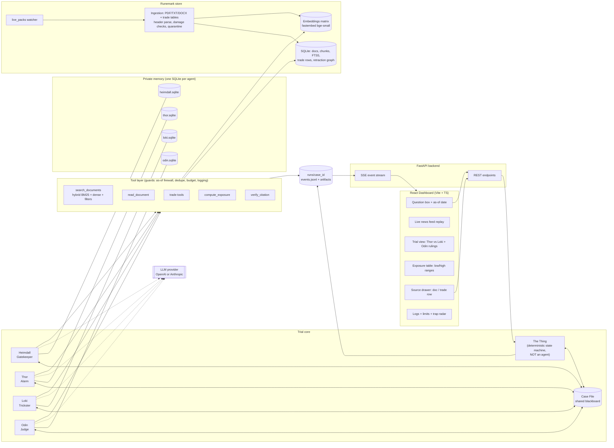
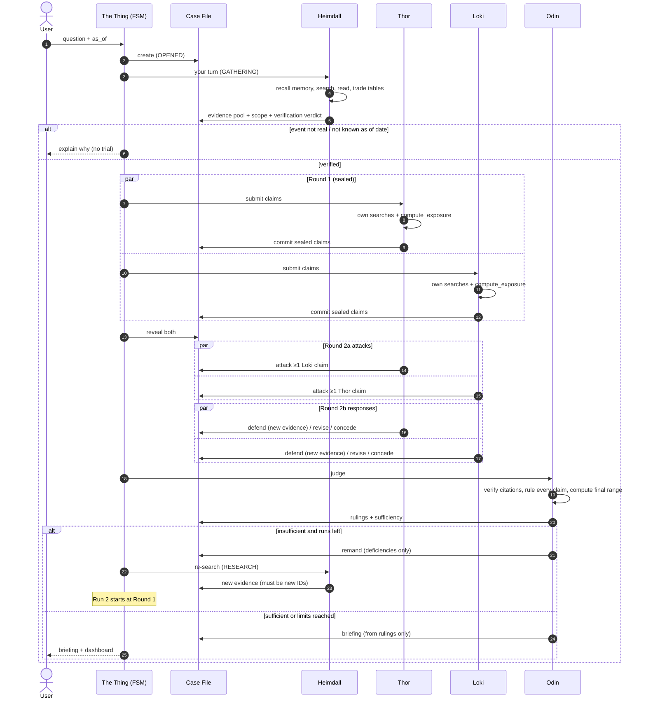

# Architecture

> Required for judging. Present the diagram below and go through §3 ("Why there is no boss").

## 1. System diagram



**How to read it:** the user is the only one who opens a case. The **Thing** moves the Case File from state to state and wakes the agent whose turn it is. Agents work **only** through their own tools and their own memory, and talk to each other **only** through the Case File. Every tool call, claim, ruling and memory access becomes an event in `events.jsonl`, which streams to the dashboard.

## 2. One run, step by step



## 3. Why there is no boss (talk track for judges)

| Concern in the PS | How the architecture meets it |
|---|---|
| "Exactly four agents" | Heimdall, Thor, Loki and Odin are the only LLM-driven components. The Thing contains **no LLM**. |
| "No central planner" | The Thing is like **court rules of procedure**. It only knows *whose turn it is* and *what the limits are*. It never reads claims, never picks queries and never assigns work. Agents pick their own tools, queries and claims, and decide for themselves whether to concede. |
| "Odin is a judge, not a boss" | Odin's outputs are rulings, a sufficiency verdict and a list of **deficiencies**. He has no tool to message Thor, Loki or Heimdall and no tool to search. Heimdall reacts to the remand on his own terms. |
| "A plain loop between two cooperating agents does not qualify" | The agents are adversarial (opposite objectives), work in **sealed** parallel submissions, must cross-examine each other, and face an independent judge plus a gatekeeper. |
| "Agents share only the Case File" | Memory lives in separate SQLite files, each owned by one agent object. There is no cross-agent tool, and agents exchange no messages directly. |

Pattern name: a **blackboard architecture** with a **finite-state protocol**. Each agent's trigger is a Case File state, not an instruction from another agent.

## 4. Components

| Component | Responsibility | Key tech | Spec |
|---|---|---|---|
| Ingestion | Parse PDF/TXT/DOCX + trade tables, parse headers, detect damage, dedupe, quarantine, incremental index, watch `live_packs/` | PyMuPDF, python-docx, charset-normalizer, ftfy, watchdog | [DATA_PIPELINE.md](DATA_PIPELINE.md) |
| Store | Docs, chunks, FTS5 index, trade rows with quality flags, retraction graph, reference sheets | SQLite (WAL) | [DATA_PIPELINE.md](DATA_PIPELINE.md) |
| Hybrid search | BM25 + dense + RRF, 7 metadata filters, as-of aware | FTS5, fastembed, numpy | [SEARCH_AND_TOOLS.md](SEARCH_AND_TOOLS.md) |
| Tool layer | Typed tools, per-agent allowlists, guards (as-of, dedupe, budget, logging, error wrapping) | pydantic v2 | [SEARCH_AND_TOOLS.md](SEARCH_AND_TOOLS.md) |
| Agents | Four role-specific tool-using loops | provider-agnostic `LLMClient` | [AGENT_SPECS.md](AGENT_SPECS.md), [PROMPTS.md](PROMPTS.md) |
| The Thing | State machine, sealed bids, round validation, limits, failure handling | asyncio | [TRIAL_PROTOCOL.md](TRIAL_PROTOCOL.md) |
| Case File | Shared, versioned blackboard. Append-only per run | pydantic + JSON | [CASE_FILE_SCHEMA.md](CASE_FILE_SCHEMA.md) |
| Validators | Citation, claim, defence and briefing validators | rapidfuzz | [TRAPS_AND_RELIABILITY.md](TRAPS_AND_RELIABILITY.md) |
| Exposure calculator | Deterministic exposure from cited parameter ranges | pure Python | [EXPOSURE_MODEL.md](EXPOSURE_MODEL.md) |
| Memory | Private, lasting per-agent memory with `knowledge_date` | SQLite + embeddings | [MEMORY.md](MEMORY.md) |
| Observability | Event log, artifacts per run, replay | JSONL, structlog | [OBSERVABILITY.md](OBSERVABILITY.md) |
| API | REST + SSE | FastAPI, sse-starlette | [API.md](API.md) |
| Dashboard | Question box, feed, trial view, exposure table, click-through, logs | React, Tailwind, Zustand, TanStack Query | [DASHBOARD.md](DASHBOARD.md) |

## 5. Repository layout

```
nine-realms/
├── README.md  BRAINSTORM.md  CLAUDE.md  AGENTS.md  TASKS.md  .env.example
├── Makefile  docker-compose.yml
├── docs/                         # all specs (this folder)
├── backend/
│   ├── pyproject.toml
│   ├── app/
│   │   ├── main.py               # FastAPI app, startup (index load, watcher, model warmup)
│   │   ├── config.py             # Settings from .env (limits, models, paths)
│   │   ├── api/                  # cases.py, docs.py, trade.py, feed.py, ingest.py, stream.py, memory.py
│   │   ├── ingest/               # manifest.py, header.py, parsers/{pdf,docx,txt}.py,
│   │   │                         # trade_table.py, damage.py, reference.py, watcher.py, pipeline.py
│   │   ├── store/                # db.py (schema + migrations), repo.py
│   │   ├── search/               # fts.py, dense.py, hybrid.py, filters.py
│   │   ├── tools/                # registry.py, guards.py, search_tools.py, trade_tools.py,
│   │   │                         # exposure.py, citation.py, memory_tools.py, submit_tools.py
│   │   ├── agents/               # base.py (tool loop), heimdall.py, thor.py, loki.py, odin.py
│   │   │   └── prompts/          # shared.md, heimdall.md, thor.md, loki.md, odin.md, reflect.md
│   │   ├── trial/                # thing.py (FSM), casefile.py, limits.py, validators.py, sufficiency.py
│   │   ├── memory/               # store.py, recall.py, reflect.py
│   │   ├── briefing/             # digest.py, render.py, validate.py
│   │   ├── llm/                  # client.py (interface), openai_client.py, anthropic_client.py
│   │   └── obs/                  # events.py (bus), logger.py, artifacts.py, replay.py
│   ├── cli.py                    # ingest | ask | replay | score | memory-reset
│   └── tests/                    # unit + fixtures (mini-Runemark with traps and damaged files)
├── frontend/
│   ├── package.json  vite.config.ts  tailwind.config.ts
│   └── src/
│       ├── api/ (client.ts, sse.ts, types.ts)
│       ├── store/ (caseStore.ts — reducer over SSE events)
│       ├── components/ (CaseBar, FeedPanel, TrialView, ClaimCard, CrossExamThread,
│       │                ExposureTable, RangeBar, BriefingView, CitationChip,
│       │                SourceDrawer, DocViewer, TradeTableViewer, LogsView, IngestionView, TrapRadar)
│       └── pages/ (App.tsx)
├── data/
│   ├── runemark/                 # given corpus (gitignored)
│   └── live_packs/               # final-round packs dropped here (watched)
├── memory/                       # heimdall.sqlite thor.sqlite loki.sqlite odin.sqlite (gitignored)
└── runs/                         # one folder per case: events.jsonl, run_N/*, briefing.md
```

## 6. Runtime and concurrency

- One FastAPI process. Each case runs as an `asyncio.Task` driven by the Thing.
- Thor and Loki run concurrently in Round 1 and in both halves of Round 2 (`asyncio.gather` with per-turn timeouts).
- SQLite runs in WAL mode. Ingestion writes in a background thread, and agents read consistent snapshots: a case pins `index_version` at open, and live-ingested docs become visible to **new** cases and to a remand re-search, which is logged.
- The embedding model is warmed at startup. Ingestion progress streams over SSE.

## 7. Configuration

Everything that tunes behaviour lives in `.env` → `config.py`: provider and models per agent, limits (runs, rounds, tool calls, tokens, timeouts, retries), verification thresholds, search weights, paths. See [.env.example](../.env.example).
