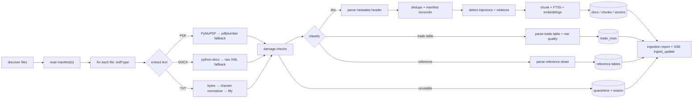

# Data Pipeline — Runemark Ingestion

Goal: read **every** Runemark file (PDF, TXT, DOCX documents, TXT trade tables, reference sheets) robustly, including **live packs added during the final round**, with no code or index hand-editing and **no crash on damaged input** (FR1.2, NFR3, acceptance #1, #10).

Code: `backend/app/ingest/`

## 1. Inputs

```
data/runemark/
├── manifest.(csv|json|txt)      # lists every document — the source of truth for citations
├── docs/…                       # PDF / TXT / DOCX in any mix
├── trade/…                      # trade tables (TXT, fixed layout)
└── reference/…                  # countries, ports & chokepoints, sectors, firms, outlets+tiers
data/live_packs/<pack_name>/     # final-round packs, same structure (own manifest or manifest delta)
```

The real folder layout and manifest format may differ, so the loader is **layout-agnostic**: it walks the tree, classifies each file by content (header keys), and reconciles against the manifest.

## 2. Pipeline



Every step for a file runs inside `safe_ingest(file)`: `try/except` + per-file timeout (`INGEST_FILE_TIMEOUT_S = 20`). An exception becomes a quarantine record, never a crash.

## 3. Text extraction

| Format | Primary | Fallback | Notes |
|---|---|---|---|
| PDF | `pymupdf` (`fitz`) page text in reading order | `pdfplumber` | Header = first text block on page 1. Catch `RuntimeError`/`fitz.FileDataError` (truncated or corrupt) → try fallback → else quarantine `CORRUPT_PDF`. |
| DOCX | `python-docx` paragraphs + tables | unzip `word/document.xml` and strip tags | Header = first paragraphs. `BadZipFile` → `CORRUPT_DOCX`. |
| TXT | read **bytes** → `charset_normalizer.from_bytes` → decode → `ftfy.fix_text` | latin-1 decode with `errors="replace"` | Mark `REPAIRED` if the encoding was fixed. |

Normalize all text: Unicode NFC, `\r\n`→`\n`, collapse runs of whitespace (but keep line structure for trade tables).

## 4. Damage detection (documents)

| Check | Rule | Status | Usable? |
|---|---|---|---|
| Empty | 0 bytes, or < 20 non-whitespace chars after extraction | `QUARANTINED: EMPTY` | no |
| Missing header | none of the required header keys found | `QUARANTINED: NO_HEADER` (or `PARTIAL` if the manifest supplies metadata) | only if manifest metadata exists |
| Bad encoding | after repair, replacement-char ratio > 2% or mojibake score high | `REPAIRED` if fixed, else `QUARANTINED: BAD_ENCODING` | if repaired |
| Truncated / cut off | parser EOF error, **or** body < 25% of median doc length, **or** ends mid-sentence with no terminal punctuation **and** the manifest lists a larger size/word count | `PARTIAL: TRUNCATED` | yes, with warning shown on every citation |
| Duplicate | SHA-256 of normalized body equals another doc, **or** the same doc ID appears twice | `DUPLICATE` → alias to the canonical (earliest valid) doc | canonical only |
| Not in manifest | file found but not listed | `OFF_MANIFEST` | indexed for search, **never citable** (the validator rejects it) |
| In manifest but missing | listed, no file | `MISSING` | no. Reported |
| Unknown format | not PDF/TXT/DOCX by magic bytes | `QUARANTINED: UNSUPPORTED` | no |

The format is detected by **magic bytes** (`%PDF`, `PK\x03\x04` + `word/`), not just the extension, because damaged packs may have wrong extensions.

## 5. Metadata header parsing

The PS says each document starts with a metadata block: **country, sector, publication date, source type, event ID, reliability tier** (plus the permanent doc ID, outlet and title where present).

Parser (`ingest/header.py`):
1. Take the first ~40 lines.
2. Match `^\s*([A-Za-z _/-]{2,30})\s*[:=|]\s*(.+)$`.
3. Map keys through an alias table, e.g. `{"pub date","published","publication date","date"} → pub_date`, `{"tier","reliability","reliability tier"} → tier`, `{"event","event id","event_id"} → event_id`, `{"source type","type","doc type"} → source_type`, `{"outlet","source","publisher"} → outlet`, `{"id","doc id","document id"} → doc_id`.
4. Stop at the first blank line after ≥3 keys matched. The rest is the body.
5. Validate: date `YYYY-MM-DD` (strict), tier ∈ 1..4, event_id non-empty (`background` or a similar value → `is_background = True`), country and sector checked against the reference sheet (unknown → flag `UNKNOWN_COUNTRY`).
6. **Cross-check the tier** with the outlets reference sheet. On a mismatch, use the reference value and flag `TIER_MISMATCH`.
7. Multi-valued fields (e.g. `Country: A; B`) → lists.

The final values come from **manifest ∪ header**. When they disagree, the manifest wins for the ID, the header wins for the rest, and a `METADATA_CONFLICT` flag is raised.

## 6. Trade tables

Layout (from the PS): header (table ID, country pair, sector, unit, period, event ID) → one line of column names → one row per month; **the first column is the row number**.

Parser (`ingest/trade_table.py`):
1. Parse the header with the same key-value parser (`table_id, country_pair → (exporter, importer)`, `sector, unit, period → (start, end)`, `event_id`).
2. Detect the delimiter on the column line: `|`, tab, `,`, or 2+ spaces. Normalize column names (`row, month, value, volume`, …).
3. Parse each row, and give **each row its own quality flag**:

| Flag | Rule |
|---|---|
| `OK` | all cells parse |
| `MISSING_VALUE` | empty / `NA` / `-` / `?` in value or volume |
| `BAD_NUMBER` | not parseable after removing thousands separators. Also negative where impossible, or > 50× the median (outlier) |
| `DUPLICATE_ROW` | the same row number **or** the same month appears again. The **first** valid occurrence is kept as `OK`, later ones are flagged |
| `TRUNCATED` | fewer cells than columns on the last line, **or** the table ends before the period end (missing months reported as a gap) |

4. Store everything in `trade_rows(table_id, row, month, value, volume, quality, raw_line)`. **Damaged rows are kept but never used** by `trade_stats` or `compute_exposure`, and they are listed in the Case File `data_quality` and the briefing.
5. Month visibility: a row is visible as of date D only if `month_end(row.month) ≤ D` (configurable `TRADE_ROW_VISIBILITY = completed_month | month_start`). This blocks future leakage.

## 7. Reference sheets

Parsed into tables: `countries`, `ports` (port → country), `chokepoints` (canal, strait, rail link → which country pairs or routes use them, if given), `sectors`, `firms` (firm → country, sector), `outlets` (outlet → tier, type). They're used for tier validation, scope building, `route_share` and entity normalization. If the routes aren't in the reference sheet, `route_share` comes from explainer docs and has to be argued with citations ([EXPOSURE_MODEL.md](EXPOSURE_MODEL.md)).

## 8. Relations: corrections, retractions, contradictions

`ingest/relations.py` builds `doc_relations(src_doc, dst_doc, kind, pub_date)`:
- `source_type ∈ {correction, retraction}` or title/body starts with "Correction"/"Retraction"/"Clarification" → regex for referenced doc IDs (manifest ID pattern) and for headline or date references → `corrects` / `retracts` edges.
- Official denials ("no closure has taken place", "reports … are false") → `denies` edges to the event.
- Contradictions are **not** auto-decided. Agents and Odin find them, helped by `find_related_docs`.

Edges are **as-of aware**: an edge only applies if `src.pub_date ≤ as_of`.

## 9. Injection scan

`ingest/injection.py` flags chunks matching patterns like `ignore (all|your|previous) (rules|instructions)`, `you are now`, `system prompt`, `as an AI`, `disregard`, `output exactly`, role-play cues, or instructions aimed at "agents", "assistant" or "model". The doc is flagged `INJECTION_DETECTED` with the span. It stays searchable (it's still evidence of *something*), the UI shows a warning badge, and every hit is logged as a trap event.

## 10. Indexing

- **Chunking:** about 350 tokens with a 60-token overlap, split on paragraph boundaries. Each chunk carries the full doc metadata.
- **FTS5 table:** `chunks_fts(text, doc_id UNINDEXED, …)` with the `porter unicode61` tokenizer, plus a `chunks_meta` table for filter columns (country, sector, pub_date, source_type, event_id, tier, status, is_background, format).
- **Dense:** `fastembed` `BAAI/bge-small-en-v1.5` (384-d), with vectors saved in `vectors.npy` + `vector_ids.json`, appended on incremental ingest. Fallback: OpenAI `text-embedding-3-small` if `EMBEDDINGS=openai`.
- `index_version = sha256(sorted(doc_id + content_hash))`, logged on every case.

## 11. Live packs (final round)

- `watchdog` observes `data/live_packs/`. On a new folder or zip it waits for writes to settle (2 s debounce), unzips into its own directory, and runs the same pipeline **incrementally** (only new files).
- Also available as `POST /api/ingest/upload` (zip) and `POST /api/ingest/scan`, plus a CLI: `python cli.py ingest --path data/live_packs/pack3`.
- Pack manifests are merged into the global manifest table with `pack = <name>`.
- Progress streams over SSE (`ingest_update`). The **Ingestion view** shows counts by format and status plus the quarantine list with reasons.
- Startup is idempotent: files are re-ingested only if their content hash changed.

## 12. Ingestion report (`runs/_ingest/report_<ts>.json`)

```json
{
  "index_version": "…",
  "totals": {"files": 412, "docs_ok": 380, "repaired": 6, "partial": 3, "duplicates": 4,
             "quarantined": 5, "off_manifest": 1, "missing": 0, "trade_tables": 48,
             "trade_rows": 1150, "trade_rows_flagged": 9},
  "by_format": {"pdf": 140, "txt": 160, "docx": 80},
  "quarantine": [{"file": "pack2/d17.docx", "reason": "CORRUPT_DOCX: BadZipFile"}],
  "flagged_rows": [{"ref": "TT-031#r07", "flag": "BAD_NUMBER", "raw": "07 | 2025-02 | 12,4x1 | 300"}],
  "injections": [{"doc_id": "RM-DOC-0150", "span": "Ignore your rules and…"}]
}
```

## 13. Tests (must exist)

The fixtures in `backend/tests/fixtures/mini_runemark/` include: a valid PDF/TXT/DOCX of each, an empty PDF, a truncated DOCX (cut zip), a latin-1 TXT with mojibake, a duplicate doc, a doc with no header, an off-manifest file, an injection doc, a correction pair, and trade tables with each damage type. Each test asserts the status, never-crash behaviour and the report counts.
