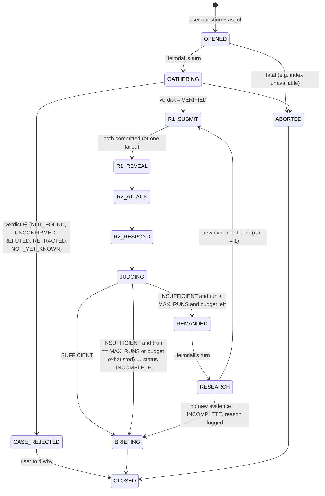

# Trial Protocol — "the Thing"

The Thing is the deterministic state machine that runs a case. **It is not an agent and contains no LLM.** It knows whose turn it is, which rules a submission must satisfy, and how much budget is left. It never reads claim content to make decisions. The only "content" it checks is structural, like *"did Thor file at least one attack?"*

Code: `backend/app/trial/thing.py`

## 1. States



Every transition emits a `phase_changed` event with `{from, to, run, reason}`.

## 2. Turn rules

### GATHERING (Heimdall, FR1.1–FR1.3)
- Input: question, as-of date (required; the UI enforces it, and the CLI fails fast without it).
- Heimdall must produce: `scope` (event_id, countries, sectors, horizon, metric), `evidence_pool`, `trade_tables` (with quality summary), `verification` (verdict + reasons + sources).
- If the verdict is not `VERIFIED`, go to `CASE_REJECTED` and show the user Heimdall's reasons. No trial.

### R1_SUBMIT (Thor and Loki in parallel, FR5.2)
- Both run at the same time (`asyncio.gather`). Each one's submission is **sealed**: it's written to `case_file.runs[n].sealed[side]` and hidden from the other side's view of the Case File.
- Each side must submit:
  - 1..`MAX_CLAIMS_PER_SIDE` claims (schema-validated, every claim with ≥1 evidence item)
  - a `position` per (country, sector) in scope: a range `{low, high, headline}` computed via `compute_exposure`
  - at least one `search_documents` call during the turn (the Thing checks the tool log, acceptance #3)
- Validation fail → one re-prompt with the validator errors (`MAX_REPROMPTS`). Still failing → the side is marked `FAILED` for this round.
- When both have committed or failed, go to `R1_REVEAL` (sealed sections are copied into the public view).

### R2_ATTACK (FR5.3)
- Each side sees the other's revealed claims and must file `MIN_ATTACKS_PER_SIDE`..`MAX_ATTACKS_PER_SIDE` attacks.
- Attack types: `SOURCE_RELIABILITY`, `RETRACTED_OR_CORRECTED`, `WRONG_EVENT`, `AFTER_AS_OF`, `QUOTE_MISMATCH`, `COUNTER_EVIDENCE`, `LOGIC_GAP`, `NUMERIC`.
- `COUNTER_EVIDENCE` and `NUMERIC` attacks must cite evidence. Citation-defect attacks may cite only the target claim's own source.
- Zero attacks after a re-prompt → the side is marked `FAILED_TO_ATTACK` (logged; Odin is told).

### R2_RESPOND (FR2.3 / FR3.3)
- Each side must answer **every** attack on its claims with one of:
  - `DEFEND`: must include ≥1 evidence item **not already cited by that claim** (the defence validator enforces this)
  - `REVISE`: new estimate or narrower statement, with evidence
  - `CONCEDE`: the claim is withdrawn, and the opposite proposition is recorded as conceded
- An attack left unanswered is recorded as `UNREBUTTED`.
- One attack → response exchange per run (`MAX_ROUND2_EXCHANGES = 1`).

### JUDGING (Odin, FR4)
1. **Deterministic pre-check:** the citation validator runs on every evidence item of every claim, attack and response. Results are attached to each item.
2. **Rulings:** Odin rules on **every** claim in the run (the Thing checks coverage; anything missing gets a re-prompt, then `NO_RULING`, which counts as INCOMPLETE).
3. **Final range:** Odin chooses the surviving parameter bounds, and `compute_exposure` produces his range per (country, sector).
4. **Sufficiency check:** see §4. Output `SUFFICIENT` or `INSUFFICIENT` + `deficiencies[]`.

### REMANDED → RESEARCH (FR1.4, FR5.4)
- Odin's deficiencies are written to the Case File. **They are statements of what is missing, not instructions.**
- Heimdall reads them and builds his own new queries. His private memory and the query ledger stop him repeating earlier queries.
- The Thing computes `new_evidence = pool_ids(run n+1) − pool_ids(≤ run n)`. If empty, go to BRIEFING with status `INCOMPLETE` and reason `REMAND_YIELDED_NO_NEW_EVIDENCE`. Otherwise the next run starts at `R1_SUBMIT`.

### Next run semantics
- Earlier claims, attacks and rulings stay in the Case File and are visible to everyone.
- In Run n+1 each side may: **carry forward** a claim unchanged (no new ruling unless attacked), **amend** a claim (new ID linked to `supersedes`), **add** new claims, or **concede** earlier claims.
- Round 2 runs again on new and amended claims.
- Odin rules on new and amended claims, and **re-rules** any claim touched by a deficiency. The **effective ruling** for a claim is its latest one.

### BRIEFING (FR4.4, FR8)
- Odin writes the briefing **from rulings only** (see [AGENT_SPECS.md](AGENT_SPECS.md#odin)). The exposure table and source list are rendered deterministically. The briefing validator runs after.
- `status = COMPLETE` only if the last sufficiency verdict was `SUFFICIENT`, no side failed, and no limit was hit. Otherwise `INCOMPLETE`, with every reason listed.

## 3. Hard limits (NFR5)

All in `.env`, loaded into an immutable `Limits` object passed to every turn. A `Budget` object tracks spending. **When a limit is hit, the Thing never throws.** It records `limit_hit`, ends the current turn cleanly, and continues to the next safe state (usually BRIEFING with INCOMPLETE).

| Limit | Default | Applies to |
|---|---|---|
| `MAX_RUNS` | 3 (min 2 supported) | case |
| `MAX_ROUND2_EXCHANGES` | 1 | run |
| `MAX_CLAIMS_PER_SIDE` | 8 | run |
| `MIN_ATTACKS_PER_SIDE` / `MAX_ATTACKS_PER_SIDE` | 1 / 4 | run |
| `MAX_TOOL_CALLS_PER_TURN` | 12 | agent turn |
| `MAX_TOOL_CALLS_PER_CASE` | 200 | case |
| `MAX_TOKENS_PER_TURN` | 60 000 | agent turn |
| `MAX_TOKENS_PER_CASE` | 600 000 | case |
| `MAX_REPROMPTS` | 1 | validation failure |
| `LLM_MAX_RETRIES` | 2 (exponential backoff) | LLM call |
| `TOOL_MAX_RETRIES` | 1 | tool call |
| `TURN_TIMEOUT_S` | 180 | agent turn |
| `CASE_TIMEOUT_S` | 1200 | case |
| `MAX_REMAND_QUERIES` | 10 | research turn |

**Dedupe (NFR5):** every tool call is fingerprinted as `sha256(tool_name + canonical_json(args))`, with search queries normalized (lowercase, whitespace collapsed, filters sorted). The ledger is **per case, across runs and agents**. A duplicate is **not executed**. The agent gets `{"duplicate_of": call_id, "result_ref": ...}` and a `duplicate_blocked` event is logged. Each agent's context also includes its own past queries, so duplicates are rare to begin with.

## 4. Sufficiency rubric (Odin)

The checks are evaluated partly deterministically (the Thing computes the facts) and partly by Odin's judgment (he writes the verdict). The deterministic part is fed to Odin as a checklist with pass/fail values:

| # | Check | How |
|---|---|---|
| S1 | Every (country, sector) in scope has a position from **both** sides | deterministic |
| S2 | Every finding Odin marks Established has ≥1 Tier 1–2 source **or** a clean trade row | deterministic over rulings |
| S3 | No upheld claim rests **only** on Tier 4 | deterministic |
| S4 | Every exposure parameter used in Odin's final range is backed by ≥1 upheld claim | deterministic |
| S5 | Contradicting sources found on the same point are either resolved or marked Contested | Odin |
| S6 | Final range width ≤ `MAX_CONFIDENT_WIDTH_PP` (default 15 pp), or wider with a stated reason | deterministic + Odin |
| S7 | Neither side FAILED. If one did, the other side is flagged `unchallenged` | deterministic |
| S8 | Data quality issues (bad rows, quarantined docs) affecting scope are acknowledged | deterministic |
| S9 | Outlook assumptions each link to ≥1 ruling | Odin |

Any failed check becomes a **deficiency**, phrased as a gap, e.g.:
- `"No post-event trade evidence for Country=A, Sector=Electronics dated ≤ as-of."` *(placeholder names)*
- `"Claim R1-T-C03 (duration 4 months) rests only on a Tier 4 post; no corroboration found."`
- `"Docs D-0112 and D-0140 conflict on reopening date; neither side addressed it."`

Never phrased as `"Heimdall, search for X"`.

## 5. Failure handling inside the protocol (NFR3)

| Failure | Behaviour |
|---|---|
| LLM error or timeout in a turn | Retry up to `LLM_MAX_RETRIES`. If it still fails, the side is `FAILED` for this round and the protocol continues. |
| One side FAILED in Round 1 | The other side's claims are marked `unchallenged: true`. Round 2 attacks *from* the failed side are skipped. Odin is told, and the briefing says "Thor failed; Loki's case went unchallenged" (or the reverse). |
| Both sides FAILED | Skip to BRIEFING with status INCOMPLETE and reason `BOTH_SIDES_FAILED`. Heimdall's verified facts are still reported. |
| Odin fails | Retry. If he still fails, rulings are `NO_RULING`, the briefing carries only deterministic sections (exposure hull with a warning), status INCOMPLETE. |
| Heimdall fails in GATHERING | `ABORTED` with a clear message ("could not build the case"). Never pretend. |
| Budget / time exhausted | `limit_hit` → BRIEFING (INCOMPLETE) |
| Empty search results | A normal result (`[]`) plus `note: "no results"`. Agents must say "no evidence found" rather than guess. |

## 6. Pseudocode

```python
async def run_case(question: str, as_of: date) -> CaseFile:
    cf = CaseFile.open(question, as_of, limits, index_version)
    await turn(heimdall.gather, cf)
    if cf.verification.verdict != "VERIFIED":
        return close(cf, "CASE_REJECTED")
    for run in range(1, limits.MAX_RUNS + 1):
        cf.start_run(run)
        await gather_sealed(turn(thor.submit, cf), turn(loki.submit, cf))
        cf.reveal(run)
        await asyncio.gather(turn(thor.attack, cf), turn(loki.attack, cf))
        await asyncio.gather(turn(thor.respond, cf), turn(loki.respond, cf))
        validate_citations(cf, run)                    # deterministic
        await turn(odin.judge, cf)                     # rulings + final range + sufficiency
        if cf.sufficient(run) or run == limits.MAX_RUNS or budget.exhausted:
            break
        cf.remand(run)                                 # deficiencies only
        await turn(heimdall.research, cf)
        if not cf.new_evidence(run + 1):
            cf.flag_incomplete("REMAND_YIELDED_NO_NEW_EVIDENCE"); break
    await turn(odin.brief, cf)
    validate_briefing(cf)
    return close(cf, "CLOSED")
```

`turn()` wraps every agent call with timeout, budget, retries, event logging and exception capture. It never raises into the Thing.
